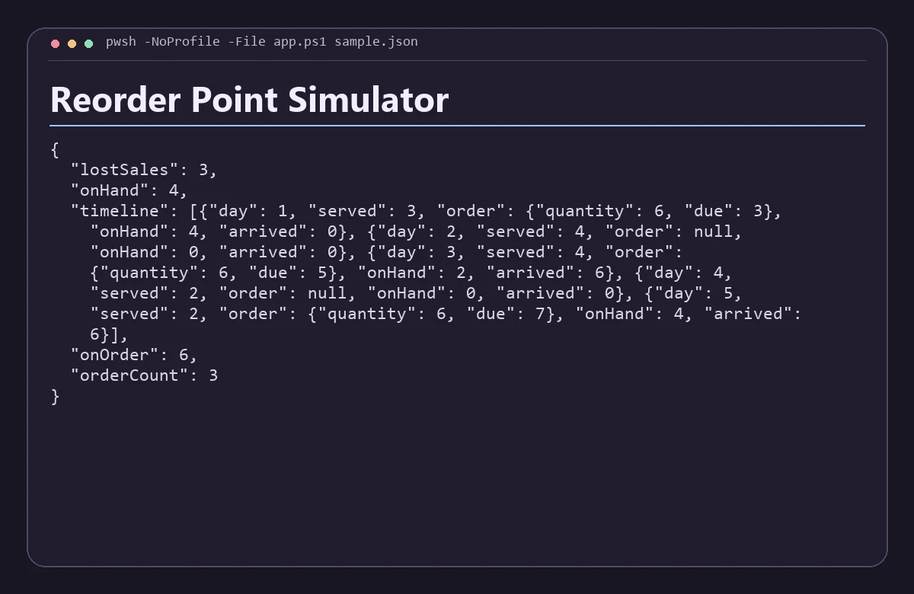

# Reorder Point Simulator

Replay daily inventory demand with a fixed replenishment quantity and lead time.



## Run

Install PowerShell 7 or newer. Run these commands from the repository root.

```sh
pwsh -NoProfile -File app.ps1 sample.json
```

Replace `sample.json` with a JSON file following the same structure. The app prints a JSON report to standard output.

Use whole units. Each day receives due orders, serves demand, then places one order if on-hand plus on-order stock is at or below the reorder point. Unfilled demand is counted as lost sales.

## Verify

Run `python check.py` with Python 3.11 or newer after the build step when applicable. The check verifies the bundled scenario and confirms that an invalid input returns an error.
